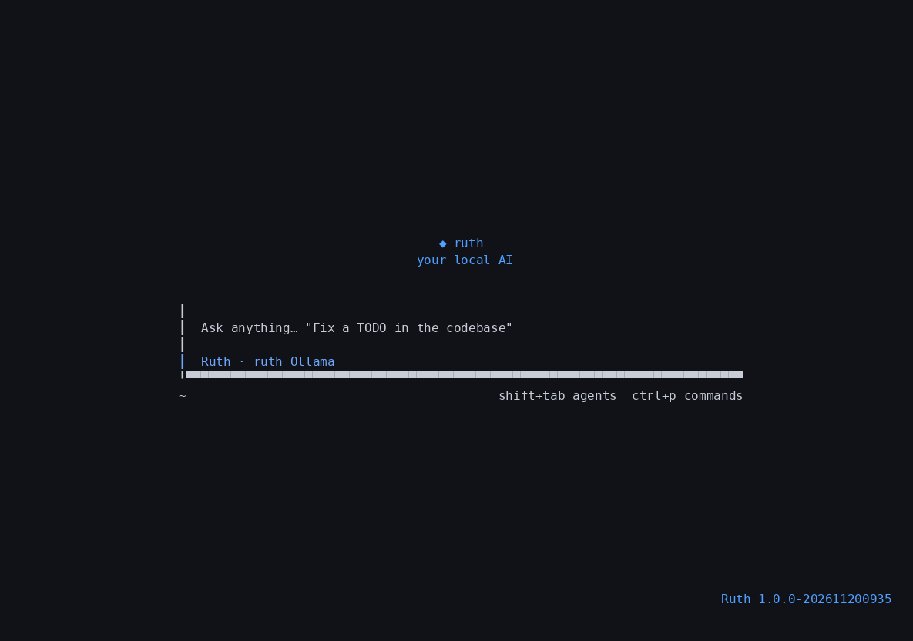
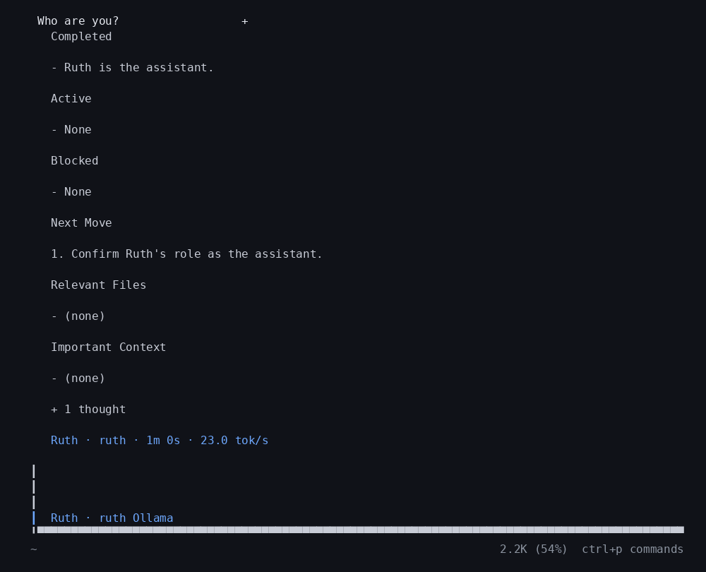

# ◆ ruth

A local-first all-purpose AI agent that runs entirely on your machine, with no cloud and no telemetry.

<p align="center">
  
</p>

## Features

- **All-purpose assistant** — ask Ruth anything in the terminal. She can answer questions, help with any task, and also read files, make edits, run commands, and keep going until the work is done.
- **Tools** — file, shell, and search tools, plus **screenshot** and **camera** tools when you need to see the screen or a photo.
- **Local models** — talks to [Ollama](https://ollama.com) on your machine. The default model is the uncensored local `ruth` model (Qwen3 1.7B, with Ruth's identity). You can point it at other local Ollama models too.
- **Offline install** — a single `ruth.run` installer can put Ruth, Ollama, and the default `ruth` model on a machine with no internet.

## Install

### Offline installer

Download `ruth.run` from the Releases page, then:

```bash
sh ruth.run
```

That installs `ruth` (and `Ruth` / `RUTH` links) into `~/.local/bin`, installs Ollama there if it is missing, and places the default `ruth` model in your local Ollama store. Nothing is downloaded.

### From source

You need [Bun](https://bun.sh). From a checkout of this repository:

To run from this tree:

```bash
bun install
bun run --cwd packages/cli src/index.ts
```

To build a linux-x64 binary:

```bash
bun install
RUTH_CHANNEL=latest RUTH_VERSION=1.0.0 RUTH_TARGET=linux-x64 bun run --cwd packages/cli script/build.ts --skip-web-ui --skip-install
```

The binary is written to `packages/cli/dist/cli-linux-x64/bin/ruth`.

## Usage

```bash
ruth
```

That opens the terminal UI. The default model is your local Ollama model `ruth`. If Ollama is installed but not running, Ruth starts it.

Config lives in `ruth.json` or `ruth.jsonc` in the project, or in `~/.config/ruth/`. Data lives in `~/.local/share/ruth`. Environment variables use the `RUTH_*` prefix.

<p align="center">
  
</p>

## Requirements

- Linux x64
- Enough memory to run the default local `ruth` model in Ollama (the model files are about 1.1 GB)
- A terminal that can display the TUI

## Security and privacy

Ruth is built to run on your computer. She does not use a cloud model provider, and she does not send telemetry. Update checks are off by default and do not call home unless you turn them on and set a release source. See [SECURITY.md](SECURITY.md) for the threat model and how to report issues.

## License

MIT. See [LICENSE](LICENSE) and [NOTICE](NOTICE). Ruth is built on an MIT-licensed foundation.

Chromebook notes are in [docs/CHROMEBOOK.md](docs/CHROMEBOOK.md).
